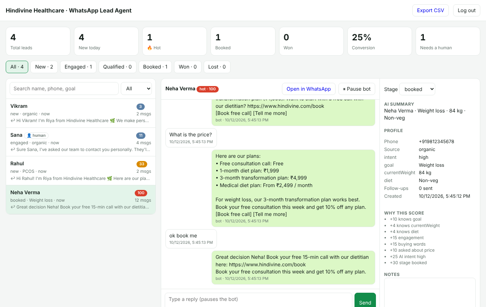

# WhatsApp Lead Agent

An all-in-one WhatsApp sales agent for **Hindivine Healthcare's 3-month weight loss programs** (Ozempic ₹19,999 · Wegovy ₹19,999 · Mounjaro ₹29,999). It answers every lead instantly, checks eligibility details, quotes the programs, books the doctor consultation, follows up with leads who go quiet, and alerts the team when a lead is hot. Everything is tracked in a small CRM dashboard.



## What it does

| | |
| --- | --- |
| **Instant auto-reply, 24×7** | Every WhatsApp message gets a reply in seconds, in English, Hindi or Hinglish. Claude writes the replies; without an API key a built-in rule-based sales flow runs instead (and takes over automatically if Claude is ever unavailable). |
| **Qualifies like a salesperson** | Asks one question at a time: weight and height, age, conditions and medicines, preferred program, start date. Uses quick-reply buttons so leads answer with one tap. |
| **Converts** | Quotes the three programs and what the kit includes from `config/business.json`, handles price, injection-fear and trust objections, mentions the offer, and sends the phone number and booking link as soon as the lead shows buying intent. It never invents prices or promises results. |
| **Medical safety** | These are prescription medicines, so the agent never picks a medicine, suggests a dose or says it is safe for someone: the doctor decides after the consultation. Pregnancy or breastfeeding, under 18, type 1 diabetes, pancreatitis, thyroid cancer/MEN2, eating disorders and reported side effects are caught by a fixed check (not the AI), which hands the chat to the doctor and alerts the team. |
| **Lead capture & source tracking** | Every number becomes a lead with name, profile, AI summary and full chat. Click-to-WhatsApp ad clicks are tagged with the ad headline. |
| **Lead scoring (0–100)** | Hot / warm / cold, from profile completeness, buying and price words, urgency, AI-judged intent, stage, ad source and silence. The dashboard shows why each lead got its score. |
| **Pipeline** | New → Engaged → Qualified → Booked → Won / Lost. Stages move forward automatically; change them by hand at any time. |
| **Follow-ups** | Leads who stop replying get a nudge after 2 h and a booking reminder after 5 h (inside WhatsApp's 24-hour window), then your approved template after 3 and 7 days. Only during business hours, and they stop as soon as the lead replies. |
| **Human handoff** | Anyone asking for a person, a refund or with a serious issue is passed to the team, and the bot goes quiet. Replying from the dashboard also pauses the bot; *Resume bot* hands the chat back. |
| **Hot-lead alerts** | Team numbers in `ALERT_NUMBERS` get a WhatsApp message when a lead turns hot, gets the booking link, or needs a human. |
| **Compliance** | `STOP` opts a lead out (`START` opts back in), webhook signatures are verified, repeated webhook deliveries are ignored, and only templates are sent outside the 24-hour window. |
| **Dashboard** | Stats, pipeline, search and filters, full chat, reply box, notes, stage changes, pause/resume bot and CSV export. Works on phones. |

## Setup

Needs Node 18+.

```sh
cd whatsapp-agent
npm install
cp .env.example .env      # then fill it in (see below)
npm start                 # http://localhost:3000/dashboard
```

Without `WHATSAPP_TOKEN` the agent runs in dry-run mode and only logs the messages it would send, which is handy for trying it out.

### 1. WhatsApp Cloud API

1. At [developers.facebook.com](https://developers.facebook.com) create a **Business** app and add the **WhatsApp** product.
2. Under *WhatsApp → API Setup*, add your business phone number. Copy the **Phone number ID** into `WHATSAPP_PHONE_NUMBER_ID`.
3. Create a **System User** in Business Settings with the `whatsapp_business_messaging` permission and generate a permanent token for `WHATSAPP_TOKEN`.
4. Copy *App settings → Basic → App secret* into `WHATSAPP_APP_SECRET`.
5. Deploy the agent on an HTTPS URL (Render, Railway, a VPS behind Nginx, etc.). Under *WhatsApp → Configuration*, set the webhook to `https://your-domain/webhook` with your `WHATSAPP_VERIFY_TOKEN`, and subscribe to the **messages** field.

### 2. Follow-up template (optional but recommended)

WhatsApp only allows approved templates more than 24 hours after a lead's last message. In WhatsApp Manager, create a *Marketing* template named `lead_followup` with one variable, for example:

> Hi {{1}}, this is Riya from Hindivine Healthcare 🌿 Your doctor consultation for our 3-month weight loss program is still available. Reply YES and we'll book a time that suits you.

Set `FOLLOWUP_TEMPLATE_NAME` / `FOLLOWUP_TEMPLATE_LANG` to match. Leave the name blank to skip template follow-ups.

### 3. Claude (AI replies)

Set `ANTHROPIC_API_KEY`. The default model is `claude-opus-5-5` at `CLAUDE_EFFORT=low`, which keeps replies fast; use `medium` for more careful answers. Each reply is one request that returns the message, quick-reply buttons, the updated lead profile, buying intent, the next action (book, hand off, mark lost) and a one-line summary for the team. Requests use server-side refusal fallbacks (`fallbacks: "default"`), and the business prompt is prompt-cached.

### 4. Your business details

Edit `config/business.json`: agent name, phone, programs and prices, what's included, offer, FAQs, booking/payment links, business hours, languages and rules. Both Claude and the rule-based flow read it, so you never have to touch the code to change what the agent says.

### 5. Team alerts

Put team WhatsApp numbers (with country code) in `ALERT_NUMBERS`. WhatsApp only delivers free-form messages to numbers that have messaged your business number in the last 24 hours, so each team member should message the business number once a day (or switch alerts to a template).

## Dashboard and API

Open `/dashboard` and enter `DASHBOARD_TOKEN`. The same token works as a Bearer token for the API:

| Method | Path | |
| --- | --- | --- |
| GET | `/api/stats` | Totals, conversion rate, counts by stage, temperature and source |
| GET | `/api/leads?q=&stage=&temperature=` | Lead list (without full chats) |
| GET | `/api/leads/:phone` | One lead with its full chat |
| PATCH | `/api/leads/:phone` | Update `name`, `stage`, `notes`, `tags`, `botPaused` |
| POST | `/api/leads/:phone/send` | Send `{ "text": "..." }` as the team (pauses the bot unless `"pauseBot": false`) |
| GET | `/api/export.csv` | All leads as CSV |

## Data

Leads are stored in `data/leads.json` (git-ignored), written atomically. That's fine for one server and thousands of leads. To scale beyond that, replace `src/store.js` with a database; nothing else needs to change. Back up the `data/` folder.

## Test

```sh
npm test      # no network or API key needed
```

## Files

| Path | Purpose |
| --- | --- |
| `src/server.js` | HTTP server: webhook, dashboard, API, follow-up timer |
| `src/agent.js` | Handles each message end to end: capture, opt-out, handoff, reply, score, alerts, follow-ups |
| `src/brain.js` | Claude replies (structured output), the rule-based fallback and the medical red-flag check |
| `src/scoring.js` | Lead score, temperature and automatic stage changes |
| `src/whatsapp.js` | WhatsApp Cloud API client, signature check, webhook parsing |
| `src/store.js` | JSON-file lead store |
| `config/business.json` | Services, prices, offer, FAQs, hours and rules |
| `public/dashboard.html` | CRM dashboard |
